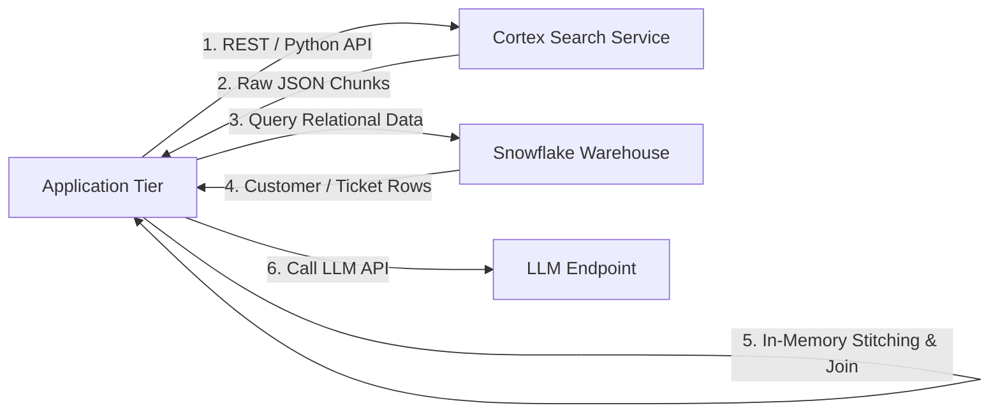
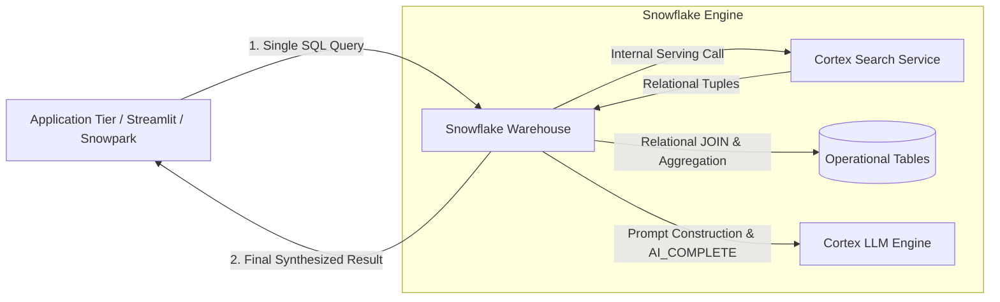
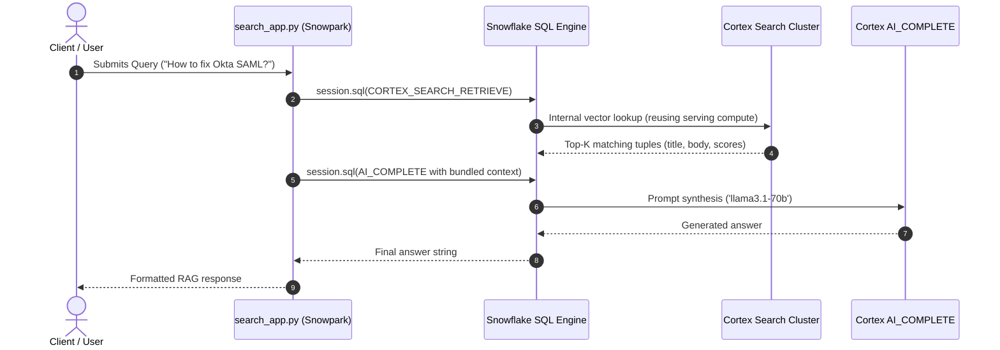

# Architecture Design: SQL-Native Semantic Retrieval

## 1. Problem & Context
Building applications that combine unstructured semantic search with structured operational data has historically forced developers to bridge two distinct execution planes:
1. **Unstructured Vector/Keyword Search**: Served via external REST/Python APIs against an indexed search cluster.
2. **Relational Data**: Queried via standard SQL against a database warehouse.

This decoupled architecture introduced latency overhead, operational complexity, synchronization lag, and prevented relational pushdowns (such as joining real-time customer tier metadata with retrieved context).

---

## 2. Before vs. After Architecture

### Before: Decoupled API-Tier Retrieval

*Friction points:*
- **Two round trips** across the network per user request.
- Client applications must implement their own in-memory joins and filters.
- RBAC is fragmented between Snowflake SQL permissions and API token scopes.

---

### After: SQL-Native Retrieval (`CORTEX_SEARCH_RETRIEVE`)

*Architectural Delta:*
- **Zero intermediate network hops**: Retrieval, business joins, aggregations, and LLM synthesis happen within a single SQL evaluation graph.
- **Unified RBAC**: Standard `USAGE` on the Cortex Search Service and `SELECT` on relational tables.
- **Composable SQL**: Standard SQL constructs (`LATERAL`, `GROUP BY`, `QUALIFY`, `WINDOW`) work directly on search output.

---

## 3. Application Architecture: `search_app.py`

The reference client application (`app/streamlit/search_app.py`) demonstrates how lightweight client tiers become when vector search is native to Snowflake:

### Application Design Principles
1. **Zero External Vector Libraries**: No LangChain, LlamaIndex, or third-party vector store dependencies required.
2. **Session-Native Security**: Inherits active Snowflake session credentials (`get_active_session()`) with zero token exposure.
3. **Structured Scoring & Filtering**: Leverages `OBJECT_CONSTRUCT` for metadata filtering (`@eq`) and retrieves component scores (`cosine_similarity`, `reranker_score`, `text_match`) directly from `METADATA$RESULT_DETAIL`.
