# Decision Guide: Latency, FinOps, & Architectural Trade-Offs

## 1. Interface Comparison Matrix

Snowflake provides three primary execution surfaces for Cortex Search: `CORTEX_SEARCH_RETRIEVE`, `CORTEX_SEARCH_BATCH`, and the Python / REST API.

| Dimension / Metric | `CORTEX_SEARCH_RETRIEVE` (SQL) | `CORTEX_SEARCH_BATCH` (SQL) | Python / REST API |
| :--- | :--- | :--- | :--- |
| **Release Status** | **Public Preview** (Oct 23, 2026) | **General Availability** (May 18, 2026) | **General Availability** |
| **Target Workload** | Real-time RAG, interactive apps, live triage (1–500 rows) | Offline entity resolution, batch deduplication, clustering (10K–10M+ rows) | External web apps, microservices outside Snowflake |
| **Execution Surface** | Snowflake SQL Table Function | Snowflake SQL Table Function | HTTP Endpoint / `snowflake.core` Python API |
| **Throughput & Concurrency** | Optimized for low-latency individual queries | Optimized for high-throughput bulk scans | Optimized for low-latency point queries |
| **Compute Engine** | Shared Search Serving Cluster + Virtual Warehouse | Dedicated Serverless Batch Engine | Search Serving Cluster |
| **FinOps Cost Model** | Service serving fee + virtual warehouse runtime (No per-query embedding fee) | Dedicated serverless compute + query embedding cost | Service serving fee only |
| **Relational Pushdowns** | Native SQL (`JOIN`, `GROUP BY`, `QUALIFY`, `WINDOW`) | Native SQL (`JOIN`, `GROUP BY`) | Application-side in-memory joins only |
| **Error Handling** | Per-row error isolation (`METADATA$ERROR`) | Per-row error isolation (`METADATA$ERROR`) | HTTP Status Codes (4xx / 5xx) |
| **Secure Data Sharing** | ❌ Not supported on direct shares / listings | ❌ Not supported | ✅ Supported across shared accounts |

---

## 2. Latency Deep Dive: Real-Time vs. Batch vs. Decoupled API

```mermaid
gantt
    title Retrieval Latency Profiles
    dateFormat  X
    axisFormat %s ms

    section REST / Python API
    Network Hops (Gateway & TLS)      :a1, 0, 80
    Vector Serving Lookup              :a2, after a1, 40
    App-Side Deserialization & Join    :a3, after a2, 35

    section CORTEX_SEARCH_RETRIEVE
    Virtual Warehouse Query Parse      :b1, 0, 15
    Internal Serving Engine Lookup     :b2, after b1, 40
    Relational Join & Pushdown         :b3, after b2, 10

    section CORTEX_SEARCH_BATCH
    Batch Task Scheduling & Sharding   :c1, 0, 800
    Serverless Distributed Scan        :c2, after c1, 1500
```

### Key Latency Characteristics
1. **`CORTEX_SEARCH_RETRIEVE` (SQL)**:
   - Eliminates egress and ingress round-trip serialization over HTTP.
   - Reuses warm serving nodes for sub-100ms response times.
   - *Latency Gotcha*: Inactive services incur an initial cold-start delay when auto-suspend wakes up.
2. **`CORTEX_SEARCH_BATCH` (SQL)**:
   - Incurs startup overhead while serverless workers initialize and partition input datasets.
   - Yields massive throughput gains on large-scale datasets (millions of rows).
3. **REST / Python API**:
   - Ideal when client applications live outside Snowflake (e.g. FastAPI / Node.js).
   - Incurs double round-trip network overhead when combined with tabular SQL lookups.

---

## 3. FinOps & Compute Billing Boundaries

Understanding who pays for what avoids budget surprises:

### `CORTEX_SEARCH_RETRIEVE` Cost Structure
- **Search Serving Cost**: Reuses the continuous serving cluster provisioned for the Cortex Search service.
- **Warehouse Runtime**: Consumes credits only for the duration the query warehouse executes the SQL statement (`JOIN`, `WHERE`, `LISTAGG`, `AI_COMPLETE`).
- **No Extra Embedding Fee**: You are *not* billed an extra per-token query embedding cost for retrieval calls.

### `CORTEX_SEARCH_BATCH` Cost Structure
- **Serverless Compute**: Billed separately based on the number of serverless compute-hours consumed.
- **Query Embedding Fee**: Billed for the tokens embedded during the batch execution.
- **Independent Scaling**: Does not contend with or consume the active search serving cluster.

---

## 4. Production Decision Framework

### When to Choose `CORTEX_SEARCH_RETRIEVE`
- **In-Database RAG**: Building chat or search inside Streamlit in Snowflake or Snowflake Worksheets using `AI_COMPLETE`.
- **Context Enrichment on Small/Medium Sets**: Joining live operational tables (e.g. daily support queue or error stream) against knowledge bases.
- **Unified Security & Governance**: Workloads requiring strict adherence to Snowflake RBAC and audit logging via `QUERY_HISTORY`.

### When to Choose `CORTEX_SEARCH_BATCH`
- **Large-Scale Entity Resolution**: Matching customer master records across millions of rows.
- **Historical Backfills**: Classifying or tagging large historical text archives.

### When to Choose the REST / Python API
- **External Web Microservices**: Serving search bars directly from React / Next.js applications hosted outside Snowflake.
- **Cross-Account Data Sharing**: Accessing search services published through Snowflake Data Shares or Marketplace listings.
