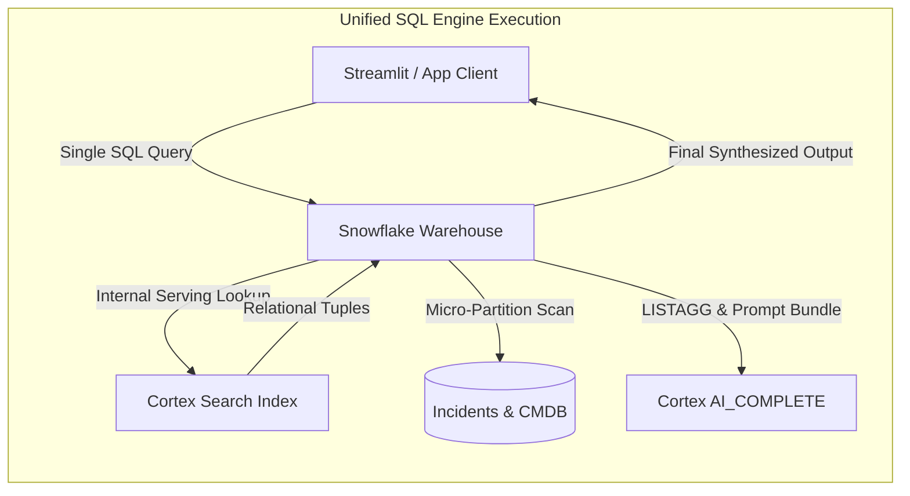

# Stop Orchestrating RAG Outside Snowflake: What Happened When I Moved Vector Retrieval into SQL

**Subtitle:** *Why moving from REST/Python search endpoints to `CORTEX_SEARCH_RETRIEVE` collapsed our multi-hop latency and fixed the enterprise context-stitching bottleneck.*

---

## TL;DR & Real-World Outcomes
If you are building Retrieval-Augmented Generation (RAG) or interactive search apps on Snowflake, you likely run a familiar pattern: query the Cortex Search REST/Python API from an external backend or Streamlit, parse raw JSON chunks, run separate SQL queries to join customer/security metadata, and stitch the prompt in memory before calling an LLM.

Snowflake’s `CORTEX_SEARCH_RETRIEVE` table function (Public Preview, Oct 23, 2026) moves semantic vector retrieval directly into the SQL query planner.

In this article, you will learn:
1. **The Architectural Shift**: How replacing an external retrieval tier with SQL-native table functions eliminates network hops and serialization overhead.
2. **Real Implementation Beyond Doc Snippets**: A production-ready incident triage engine that correlates live IT/security alerts against historical post-mortems with relational tier filtering and error boundary isolation.
3. **FinOps & Latency Trade-Offs**: Why `CORTEX_SEARCH_RETRIEVE` shares serving compute with zero per-query embedding fees, when cold starts hit, and when to route workloads to `CORTEX_SEARCH_BATCH`.
4. **Complete Source Code**: Access the accompanying production monorepo containing DDL, setup scripts, Streamlit apps, and CI validation.

> 📦 **GitHub Repository:** [cortex-search-retrieve-rag](https://github.com/snowflake-labs/cortex-search-retrieve-rag) *(Sample monorepo implementation ready to deploy)*  
> 💡 **Hands-On Application Script:** See [`app/streamlit/search_app.py`](https://github.com/snowflake-labs/cortex-search-retrieve-rag/blob/main/app/streamlit/search_app.py) for a complete, runnable Snowpark Python script implementing this RAG pipeline end-to-end.

---

## The Friction: Why Decoupled Vector APIs Break in Enterprise Workloads

Most enterprise RAG architectures separate the unstructured search engine from the relational warehouse. Even with native Cortex Search, using the REST or Python endpoint introduces a two-tier execution split:

```mermaid
flowchart TD
    subgraph Multi-Tier Glue Code (High Latency & Fragile)
        Client[Application / Webhook] -->|1. REST Search Call| CS[Cortex Search Service API]
        CS -->|2. Return JSON Payload| Client
        Client -->|3. SQL Query for Dim Data| WH[Snowflake Warehouse]
        WH -->|4. Return Customer/SLA Rows| Client
        Client -->|5. In-Memory Stitching & Deduplication| Client
        Client -->|6. SQL / Cortex Complete Call| LLM[Cortex AI_COMPLETE]
    end
```

### Where This Architecture Breaks Down
1. **The Two-Hop Network Penalty**: Each user request requires round trips across API gateways, JSON serialization/deserialization, and separate database connections.
2. **Impossible Relational Pushdowns**: If you want to know *"Which incident post-mortems match our open P1 tickets for Fortune 500 accounts?"*, you cannot filter by customer tier *inside* the vector search without syncing all operational relational columns into the search service index.
3. **Governance & Audit Drift**: Your audit logs are fragmented across API gateway logs, application middleware traces, and Snowflake's `QUERY_HISTORY`.

---

## The Architectural Change: Retrieval as a Relational Operator

With `CORTEX_SEARCH_RETRIEVE`, vector and keyword search is evaluated as an in-database table function:



This changes the mental model: **semantic search is no longer a separate microservice call; it is a relational relation you can join, group, and filter.**

---

## Hands-On Scenario: Automated Incident Triage & Root Cause Recommendation

Let's look at a realistic production case: an automated reliability platform that takes incoming live service alerts, runs semantic retrieval against historical engineering post-mortems, joins active CMDB tier metadata, and auto-generates resolution playbooks.

### 1. The Production Schema & Cortex Search Service

First, define the corpus of historical engineering post-mortems and live incoming alerts:

```sql
-- Create operational tables for post-mortems and live incoming alerts
CREATE OR REPLACE TABLE PROD_OPS.RELIABILITY.INCIDENT_POSTMORTEMS (
    INCIDENT_ID VARCHAR(32) PRIMARY KEY,
    SERVICE_NAME VARCHAR(64) NOT NULL,
    SEVERITY VARCHAR(8) NOT NULL,
    ROOT_CAUSE_TEXT VARCHAR NOT NULL,
    RESOLUTION_STEPS VARCHAR NOT NULL,
    LAST_UPDATED TIMESTAMP_NTZ DEFAULT CURRENT_TIMESTAMP(),
    RESOLVED_AT TIMESTAMP_NTZ DEFAULT CURRENT_TIMESTAMP()
);

CREATE OR REPLACE TABLE PROD_OPS.RELIABILITY.LIVE_ALERTS (
    ALERT_ID VARCHAR(32) PRIMARY KEY,
    AFFECTED_SERVICE VARCHAR(64) NOT NULL,
    SEVERITY VARCHAR(8) NOT NULL,
    ERROR_MESSAGE VARCHAR NOT NULL
);

-- Cortex Search Service indexing root cause text and carrying LAST_UPDATED
CREATE OR REPLACE CORTEX SEARCH SERVICE PROD_OPS.RELIABILITY.POSTMORTEM_SEARCH_SERVICE
    ON ROOT_CAUSE_TEXT
    ATTRIBUTES SERVICE_NAME, SEVERITY, INCIDENT_ID
    WAREHOUSE = SEARCH_APP_WH
    TARGET_LAG = '1 hour'
    AS (
        SELECT
            INCIDENT_ID,
            SERVICE_NAME,
            SEVERITY,
            ROOT_CAUSE_TEXT,
            RESOLUTION_STEPS,
            LAST_UPDATED
        FROM PROD_OPS.RELIABILITY.INCIDENT_POSTMORTEMS
    );
```

---

### 2. The Multi-Row `LATERAL` Triage Pattern (With Dynamic Per-Row Scoring)

When new incidents arrive in `LIVE_ALERTS`, we need to triage all of them simultaneously. We use `LATERAL CORTEX_SEARCH_RETRIEVE` to query the index per alert, dynamically adjusting vector-vs-keyword weights based on alert severity:

```sql
-- Real-time incident matching across a batch of incoming alerts with freshness verification
SELECT
    a.ALERT_ID,
    a.AFFECTED_SERVICE,
    a.ERROR_MESSAGE,
    pm_live.INCIDENT_ID AS HISTORICAL_MATCH_ID,
    pm_live.ROOT_CAUSE_TEXT,
    pm_live.RESOLUTION_STEPS,
    PARSE_JSON(pm_search.METADATA$RESULT_DETAIL):scores:similarity_score AS SIMILARITY_SCORE
FROM PROD_OPS.RELIABILITY.LIVE_ALERTS AS a,
LATERAL CORTEX_SEARCH_RETRIEVE(
    service_name => 'PROD_OPS.RELIABILITY.POSTMORTEM_SEARCH_SERVICE',
    query => a.ERROR_MESSAGE,
    filter => OBJECT_CONSTRUCT('@eq', OBJECT_CONSTRUCT('SERVICE_NAME', a.AFFECTED_SERVICE)),
    limit => 1,
    query_options => IFF(
        a.SEVERITY = 'P1',
        OBJECT_CONSTRUCT('scoring_config', OBJECT_CONSTRUCT('weights', OBJECT_CONSTRUCT('texts', 1, 'vectors', 3))),
        OBJECT_CONSTRUCT('scoring_config', OBJECT_CONSTRUCT('weights', OBJECT_CONSTRUCT('texts', 2, 'vectors', 1)))
    )
) AS pm_search
JOIN PROD_OPS.RELIABILITY.INCIDENT_POSTMORTEMS AS pm_live
    ON pm_live.INCIDENT_ID = pm_search.INCIDENT_ID
   AND pm_live.LAST_UPDATED = pm_search.LAST_UPDATED
WHERE pm_search.METADATA$ERROR IS NULL;
```

---

### 3. End-to-End SQL-Native RAG Pipeline

Instead of writing Python LangChain glue code, we can bundle retrieval, contextual ranking, and LLM synthesis into a single composable SQL query:

```sql
WITH INCOMING_PROMPT AS (
    SELECT 'Postgres connection pool exhausted under high microservice load' AS INCIDENT_SYMPTOM
),
RAW_SEARCH_RESULTS AS (
    SELECT
        p.INCIDENT_SYMPTOM,
        cs.INCIDENT_ID,
        cs.LAST_UPDATED AS INDEXED_LAST_UPDATED,
        PARSE_JSON(cs.METADATA$RESULT_DETAIL):scores:similarity_score::FLOAT AS SIMILARITY_SCORE
    FROM INCOMING_PROMPT AS p,
    LATERAL CORTEX_SEARCH_RETRIEVE(
        service_name => 'PROD_OPS.RELIABILITY.POSTMORTEM_SEARCH_SERVICE',
        query => p.INCIDENT_SYMPTOM,
        limit => 6  -- Over-fetch to protect top-k recall after dropping stale hits
    ) AS cs
    WHERE cs.METADATA$ERROR IS NULL
),
FRESH_POSTMORTEMS AS (
    SELECT
        r.INCIDENT_SYMPTOM,
        pm.INCIDENT_ID,
        pm.ROOT_CAUSE_TEXT,
        pm.RESOLUTION_STEPS,
        ROW_NUMBER() OVER (
            ORDER BY r.SIMILARITY_SCORE DESC NULLS LAST
        ) AS RANK_ORDER
    FROM RAW_SEARCH_RESULTS AS r
    JOIN PROD_OPS.RELIABILITY.INCIDENT_POSTMORTEMS AS pm
        ON pm.INCIDENT_ID = r.INCIDENT_ID
       AND pm.LAST_UPDATED = r.INDEXED_LAST_UPDATED
    QUALIFY RANK_ORDER <= 3
),
CONTEXT_AGGREGATION AS (
    SELECT
        INCIDENT_SYMPTOM,
        LISTAGG(
            '[' || RANK_ORDER || '] Post-Mortem Ref (' || INCIDENT_ID || '):\nRoot Cause: ' || 
            ROOT_CAUSE_TEXT || '\nResolution: ' || RESOLUTION_STEPS,
            '\n\n---\n\n'
        ) WITHIN GROUP (ORDER BY RANK_ORDER) AS KNOWLEDGE_CONTEXT
    FROM FRESH_POSTMORTEMS
    GROUP BY INCIDENT_SYMPTOM
)
SELECT
    INCIDENT_SYMPTOM,
    AI_COMPLETE(
        'llama3.1-70b',
        CONCAT(
            'You are an incident commander. Provide immediate actionable remediation steps based strictly on these historical post-mortems:\n\n',
            KNOWLEDGE_CONTEXT,
            '\n\nActive Incident Symptom: ', INCIDENT_SYMPTOM,
            '\n\nRecommended Action Plan:'
        )
    ) AS REMEDIATION_PLAN
FROM CONTEXT_AGGREGATION;
```

#### Putting It Together in Python: The Application Layer

Instead of maintaining separate REST clients and prompt templates, the entire retrieval-and-generation cycle reduces to a concise Snowpark function (see [`app/streamlit/search_app.py`](https://github.com/snowflake-labs/cortex-search-retrieve-rag/blob/main/app/streamlit/search_app.py)):

```python
from snowflake.snowpark.context import get_active_session

def run_search_and_rag(user_query: str, category_filter: str = "ALL", top_k: int = 2):
    session = get_active_session()
    
    filter_clause = ""
    if category_filter != "ALL":
        filter_clause = f", filter => OBJECT_CONSTRUCT('@eq', OBJECT_CONSTRUCT('CATEGORY', '{category_filter}'))"
    
    # 1. SQL-native semantic retrieval with live base table freshness re-join
    # Over-fetch from search index (top_k * 2) and join live table on LAST_UPDATED
    sql_search = f"""
    SELECT
        a.ARTICLE_ID,
        a.ARTICLE_TITLE,
        a.CATEGORY,
        a.BODY_TEXT,
        a.LAST_UPDATED,
        PARSE_JSON(cs.METADATA$RESULT_DETAIL):scores AS SCORES
    FROM TABLE(CORTEX_SEARCH_RETRIEVE(
        service_name => 'RETRIEVE_DEMO_DB.KNOWLEDGE_CORPUS.KNOWLEDGE_BASE_SEARCH_SERVICE',
        query => '{user_query.replace("'", "''")}',
        limit => {top_k * 2}
        {filter_clause}
    )) AS cs
    JOIN KNOWLEDGE_BASE_ARTICLES AS a
        ON a.ARTICLE_ID = cs.ARTICLE_ID
       AND a.LAST_UPDATED = cs.LAST_UPDATED
    WHERE cs.METADATA$ERROR IS NULL
    LIMIT {top_k}
    """
    search_df = session.sql(sql_search).to_pandas()
    
    if search_df.empty:
        return "No fresh matching articles found."
    
    # 2. SQL-native LLM synthesis
    context_text = "\\n\\n".join([f"[{r['ARTICLE_TITLE']}]: {r['BODY_TEXT']}" for _, r in search_df.iterrows()])
    sql_rag = f"""
    SELECT AI_COMPLETE(
        'llama3.1-70b',
        CONCAT('Context:\\n', '{context_text.replace("'", "''")}', '\\n\\nQuestion: {user_query.replace("'", "''")}\\nAnswer:')
    ) AS ANSWER
    """
    return session.sql(sql_rag).to_pandas()["ANSWER"].iloc[0]
```

---

## Hard-Learned Lessons, Latency, & FinOps Realities

Moving semantic search into SQL simplifies architecture, but it introduces specific engineering considerations you must plan for.

### 1. The Target Lag Consistency Gap (and the Timestamp Re-Join Fix)
When joining `CORTEX_SEARCH_RETRIEVE` results with real-time relational tables, there is a fundamental consistency boundary:
* **The Problem**: A Cortex Search Service refreshes on its configured `TARGET_LAG` (e.g. `1 hour`), while the tables you join against (`OPEN_TICKETS`, `CUSTOMERS`, `INCIDENT_POSTMORTEMS`) are real-time. If an article's metadata, severity, or content changed 10 minutes ago, the search index returns stale attributes until the next refresh.
* **The Solution**: 
  1. Pass the source row's `LAST_UPDATED` timestamp through the search index definition.
  2. In your SQL query, re-join the live base table on both `PRIMARY_KEY` and `LAST_UPDATED` (e.g. `a.ARTICLE_ID = cs.ARTICLE_ID AND a.LAST_UPDATED = cs.LAST_UPDATED`).
  3. Pull descriptive attributes (`TITLE`, `CATEGORY`, `SEVERITY`) from the **live table**, not the index output.
  4. **Over-fetch** from the index (e.g. `limit => top_k * 2`) and trim post-join with `QUALIFY RANK <= top_k` so stale-dropped chunks do not starve recall.
* **Deletes Handled Automatically**: Inner-joining the live table also silently purges index chunks whose source records were deleted between refresh intervals.

### 2. The Serving Auto-Suspend Cold-Start Trap
To minimize idle costs, Cortex Search automatically suspends its dedicated serving clusters after periods of inactivity.
* **The Gotcha**: When a query hits a suspended service, `CORTEX_SEARCH_RETRIEVE` transparently wakes it up, but that initial query pays a cold-start delay.
* **The Production Fix**: If your team operates under strict latency SLAs during business hours, warm up the serving layer ahead of time using a scheduled task:
  ```sql
  ALTER CORTEX SEARCH SERVICE PROD_OPS.RELIABILITY.POSTMORTEM_SEARCH_SERVICE RESUME SERVING;
  ```

### 3. Error Boundary Isolation in `LATERAL` Joins
When running `LATERAL CORTEX_SEARCH_RETRIEVE` across multiple input rows:
* If a single row has a malformed query string or invalid JSON filter, **it does not crash the entire query**.
* Instead, that specific row populates `METADATA$ERROR` while remaining rows return valid data.
* **Best Practice**: Always check `WHERE METADATA$ERROR IS NULL` for user-facing flows, and log rows where `METADATA$ERROR IS NOT NULL` to an observability table.

### 4. FinOps & Compute Billing Boundaries
* `CORTEX_SEARCH_RETRIEVE` reuses the **existing Cortex Search serving cluster** to execute the semantic index lookup. It does *not* charge a separate per-query embedding fee.
* The surrounding virtual warehouse handles relational joins, string aggregation, and post-filtering. An `XSMALL` warehouse is typically sufficient for interactive RAG workloads.
* By contrast, `CORTEX_SEARCH_BATCH` provisions dedicated serverless workers and bills per-query embedding tokens, making it suited strictly for bulk offline workloads (millions of rows).

---

## Architectural Decision Matrix

| Dimension | `CORTEX_SEARCH_RETRIEVE` (SQL) | `CORTEX_SEARCH_BATCH` (SQL) | REST / Python SDK |
| :--- | :--- | :--- | :--- |
| **Ideal Workload** | Real-time RAG, interactive apps, live triage (1–500 rows) | Offline deduplication, bulk entity matching (10K–10M+ rows) | External web apps, custom API gateways outside Snowflake |
| **Latency Profile** | Low latency, interactive (sub-100ms warm) | High throughput, asynchronous batch (minutes) | Low latency, interactive |
| **Compute Engine** | Shared Search Serving Cluster + Virtual Warehouse | Dedicated Serverless Batch Engine | Search Serving Cluster |
| **FinOps Cost Model** | Serving fee + Virtual Warehouse (No embedding fee) | Dedicated serverless compute + Query embedding fee | Serving fee only |
| **Relational Joins** | Native SQL (`JOIN`, `GROUP BY`, `QUALIFY`) | Native SQL (`JOIN`, `GROUP BY`) | Application-side glue code required |
| **Secure Data Sharing** | Not supported on direct shares / listings | Not supported on direct shares / listings | Supported across shared accounts |

### When to Use `CORTEX_SEARCH_RETRIEVE`
- You want to eliminate Python/REST middleware for RAG pipelines built inside Streamlit in Snowflake or SQL worksheets.
- You need to join search results against live dimensional data in the same transaction.

### When to Avoid It
- **Massive Offline Reprocessing**: If you are doing bulk record linking on millions of rows, use `CORTEX_SEARCH_BATCH`.
- **External Consumer Accounts**: If external consumers access your search service via Snowflake Marketplace or Secure Data Sharing, use the REST/Python API surface.

---

## Architectural Takeaway

The biggest win from `CORTEX_SEARCH_RETRIEVE` is not just that it runs in SQL—it is that **unstructured semantic data is no longer treated as an external second-class citizen**. 

By bringing vector search into the relational query engine, you eliminate multi-hop glue code, enforce consistent role-based access control, and combine unstructured context with live enterprise tables in a single transaction.

---

## Publication Details

* **Suggested Medium Tags**: `Snowflake`, `Data Engineering`, `Generative AI`, `SQL`, `Architecture`
* **Article Pattern**: Production Implementation & Architecture Deep Dive (Snowflake Chronicles)
* **Code Repository Link**: [cortex-search-retrieve-rag on GitHub](https://github.com/snowflake-labs/cortex-search-retrieve-rag)
* **Application Script Reference**: [`app/streamlit/search_app.py`](https://github.com/snowflake-labs/cortex-search-retrieve-rag/blob/main/app/streamlit/search_app.py) *(Snowpark Python client script)*
